# Modern Meters for 8GadgetPack

**To install, download `Install-ModernMeters.cmd` under _Assets_ on the [latest release](https://github.com/livonianlabs/modern-meters/releases/latest) and double-click it**, or download the `.gadget` files there and double-click them (see [Install](#install)). The green _Code → Download ZIP_ button gives the source code, not the gadgets. [По-русски ↓](#modern-meters-по-русски)

> **New: Modern Meters as an app.** The same meters in their own windows, without 8GadgetPack, with 45 styles,
> a live zone and easter eggs: [Modern Meters app (beta)](https://livonianlabs.github.io/modern-meters-app/).

Five desktop gadgets for the Windows Sidebar from 8GadgetPack:

| Gadget | Shows |
|---|---|
| **CPU Meter Modern** | Load of every thread or core (P-cores and E-cores grouped), clock speed, temperature, RAM and commit, history graph, how long Windows has been running, the busiest program right now (click it for Task Manager). Click the processor's name for the busiest programs by CPU and memory |
| **GPU Meter Modern** | GPU load, VRAM, memory controller or shared memory, power, fan (RPM and %), clocks, encoder/decoder, temperature, history graph, the busiest program on the card, an alarm when video memory is nearly full. Click the card's name for the programs using its memory and GPU. NVIDIA, AMD and Intel, discrete and integrated, with the same sensors Task Manager uses. With two or more cards, **All graphics cards** shows the others in a short block under the main one |
| **Network Meter Modern** | Download and upload speed with an auto-scaled graph, Wi-Fi network and signal, IP addresses (hidden until clicked), firewall, ping with a small latency graph, traffic totals |
| **Drives Meter Modern** | Physical disks with their partitions, SMART health, SSD life left, temperature, read/write speed, activity graph |
| **Weather Meter Modern** | Current weather and a colored hourly chart of temperature, precipitation, wind or pressure (switched by tabs), a rain radar map of the last 80 minutes, 3 or 5 days ahead, sunrise and sunset, UV index and air quality, and when rain or snow starts or stops within the next two hours ("rain in 20 min"). Follows you from town to town through Windows location |

The CPU and GPU gadgets show the maker (NVIDIA, AMD, Intel, Qualcomm) beside their title. Hover over a graph to see the value at that moment and its lowest, average and highest; **Graph history** makes a graph cover 5 or 15 minutes or an hour instead of the last minute or two. All of them speak 13 languages (English, Українська, Русский, Deutsch, Español, Français, Italiano, Latviešu, Polski, Português, Türkçe, 中文, 日本語) and pick yours from Windows, and have five widths, accent colors, and a five-step color scale for load and temperature. Translations live in `shared/lang/`, one file per language; corrections are welcome.

Styles: **Glass**, **Classic**, **Light**, **Colored glass** (glass in your accent color: blue, teal, green, purple, orange, pink, red or yellow), **Retro terminal** (a CRT screen with scanlines in your accent color, whose cursor now and then retypes the title), three more terminals (**black and white**, **blue commander** after the old DOS file managers, and **aubergine** after the Ubuntu terminal), **Gray 90s** (gray Windows 95/98-style windows with a navy title bar and block progress bars), **Sky glass** and **Lens glass**, **Carbon** (graphite with a fine carbon weave, glossy bars and a black graph with a green grid, after the desktop meters of the early 2010s such as AddGadgets' All CPU Meter), **Rainbow** (Carbon laid out as those meters were: every row in its own color, label, values and bar alike, running along the rainbow from row to row, long bars and one graph at the very bottom), and **Auto**, which switches between Light and Glass with Windows' light/dark mode. Sky glass and Lens glass are frosted glass, inspired by Windows 7's Aero and Apple's Liquid Glass: the gadget shows your wallpaper under it, blurred, through blue glass or through light or dark glass (picked by how bright the wallpaper is, or as you set it), with **Glass frosting** setting how much; Lens glass bends the picture along its edges like a thick lens. They redraw themselves when you move a gadget or change the wallpaper. Panels for the colored styles are drawn once on your PC the first time they're needed. Set **For all gadgets** in any gadget's settings to give every gadget the same style and language (and, if you like, accent color) in one go.

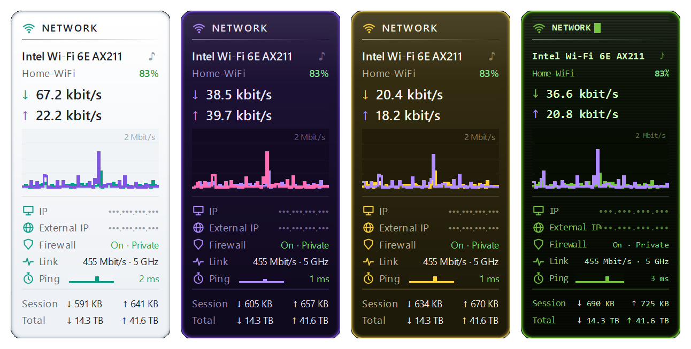

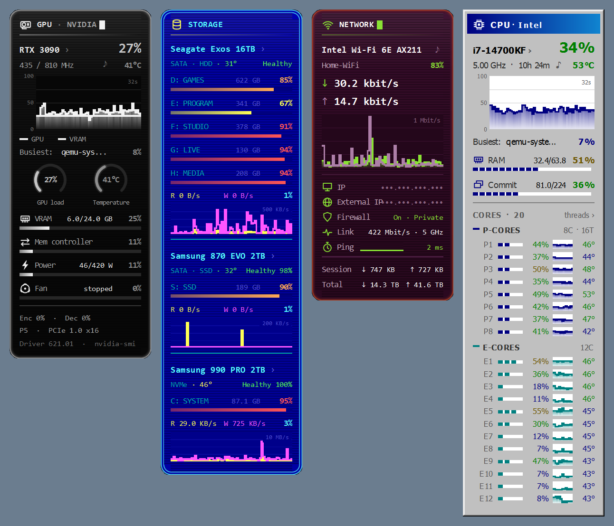

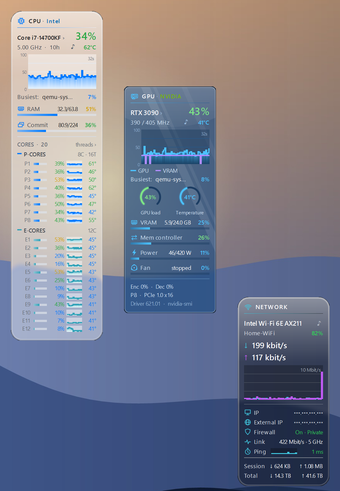

### Glass style

<table><tr valign="top">
<td></td>
<td></td>
<td></td>
<td></td>
<td>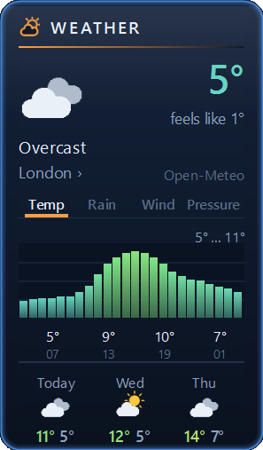</td>
</tr></table>

### Carbon style

<table><tr valign="top">
<td>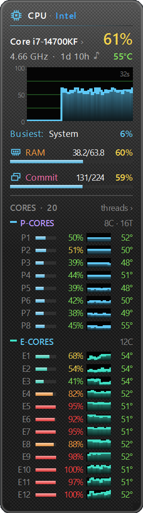</td>
<td>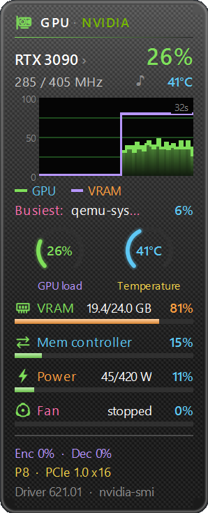</td>
<td>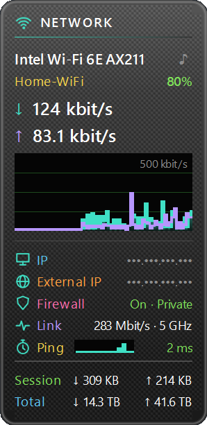</td>
<td>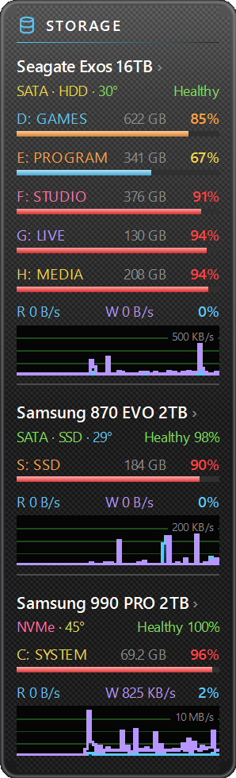</td>
<td>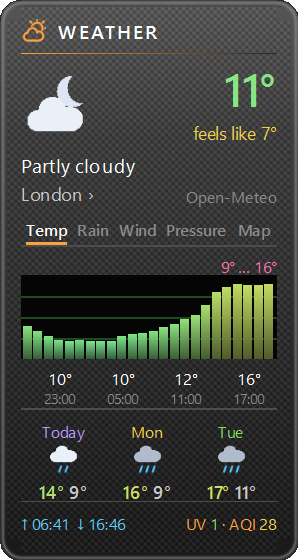</td>
</tr></table>

### Rainbow style

<table><tr valign="top">
<td>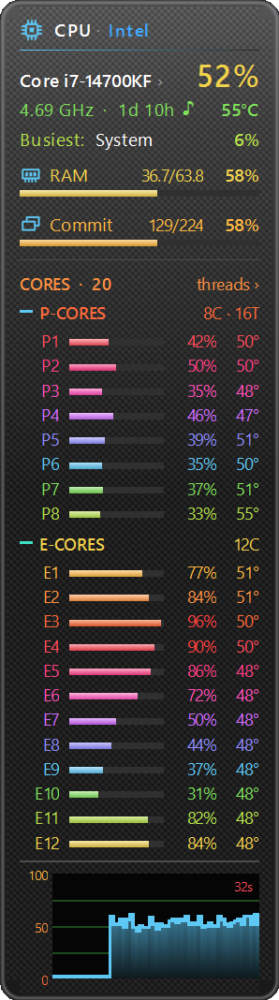</td>
<td>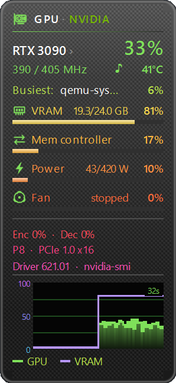</td>
<td>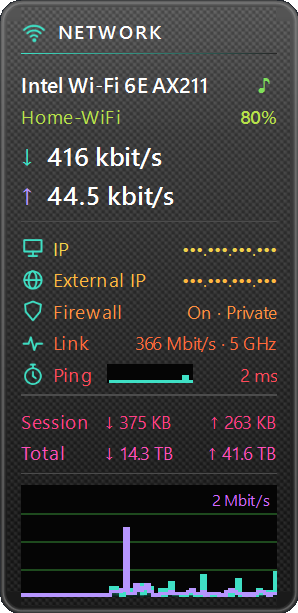</td>
<td>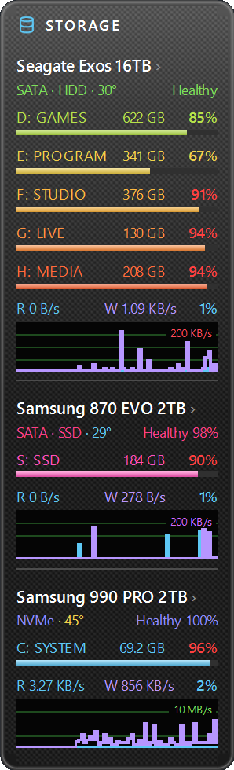</td>
<td>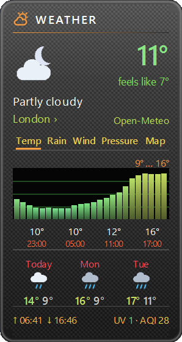</td>
</tr></table>

### Classic style

<table><tr valign="top">
<td></td>
<td></td>
<td></td>
<td></td>
<td>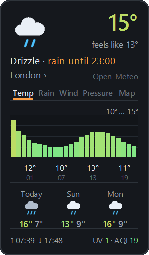</td>
</tr></table>

## Install

**With the installer** (easiest): download `Install-ModernMeters.cmd` from [Releases](https://github.com/livonianlabs/modern-meters/releases/latest) and double-click it. It checks that [8GadgetPack](https://8gadgetpack.net/) is there (and offers its site if not), installs or updates all five gadgets from the latest release, repairs the Windows performance counters if they are broken, offers to set up [Core Temp](https://www.alcpu.com/CoreTemp/) for CPU temperatures, and opens the gadget gallery. Each step that needs administrator rights asks first. The file isn't signed, so Windows may say it "protected your PC": click **More info** → **Run anyway**.

**By hand**:

1. Install [8GadgetPack](https://8gadgetpack.net/) if you don't have the Sidebar yet.
2. Download the `.gadget` files from [Releases](https://github.com/livonianlabs/modern-meters/releases/latest) and double-click each one you want. You don't need all five. Windows says it can't verify the publisher, because the gadgets aren't signed: click **Install**.
3. Right-click the desktop → **Gadgets**, and drag the gadget onto the desktop.
4. Settings: hover over the gadget and click the wrench icon.

When a new version is out, a blinking **↑ x.y.z** appears in the gadget's corner. Click it, and the gadgets download the release from GitHub, install it over themselves (all Modern Meters gadgets at once) and restart; a spinner on the badge shows how far it got, and a green **✓** the new version once they restarted. Nothing is installed without that click, unless you set Settings → **About** → **New versions** → **Install by themselves**: then the gadgets install a new version as soon as they find it. You can also install the new `.gadget` files over the old ones by hand. Coming from 1.1.0 or older, restart the Sidebar once afterwards (right-click its tray icon → Exit, then start it again).

## If a gadget shows nothing

- **"Windows counters are broken: repair ›"** (or a gadget that stays blank): the Windows performance counters that CPU, Drives, Network and GPU read are damaged, usually by a failed update or a registry cleaner. Click the line and approve the administrator prompt: it rebuilds them (`lodctr /R`, `winmgmt /resyncperf`) and the gadgets restart. The installer does the same.
- **GPU Meter says "no data" on an older NVIDIA card**: it switches to the Windows counters by itself within seconds, and still takes the temperature from nvidia-smi when Windows doesn't report it.

## Fitting them on the screen

The Sidebar doesn't move gadgets out of each other's way, so a column that is too tall overlaps. The quickest fix is the **Graph** setting: **Low** makes each gadget 15–25 px shorter. Drives Meter can also hide its graph, and CPU Meter can list cores instead of threads. With 175% scaling on a 1440p or 4K screen, all five fit in two columns (for example Weather, Drives and Network in one, GPU and CPU in the other) with Network and Weather graphs on Low.

## Optional extras

Everything works without them. They add data that Windows only gives to drivers or administrators.

| For | What to do |
|---|---|
| CPU temperature | [Core Temp](https://www.alcpu.com/CoreTemp/), a free program by Arthur Liberman. If it isn't there, click "Core Temp not running ›" on the gadget twice: after the administrator prompt it downloads the standalone Core Temp from alcpu.com (not the installer, which offers extra software) into `%LOCALAPPDATA%\ModernMeters\CoreTemp` and sets it to start minimized with Windows (the scheduled task "Modern Meters - Core Temp"). Core Temp's license doesn't allow passing it on, so it always comes from its author's site. An installed Core Temp is just started. |
| GPU temperature on integrated graphics, watts on AMD/Intel | Discrete cards report temperature, fan, clocks and power (as % of the limit) by themselves. Integrated graphics often don't report temperature; run [LibreHardwareMonitor](https://github.com/LibreHardwareMonitor/LibreHardwareMonitor/releases) to fill it in. NVIDIA cards don't need it. |
| SSD life and temperature | Drives Meter settings → **SSD life & temperature** → **Turn on**, then approve the administrator prompt. This adds the scheduled task "ModernMeters Disk Health". It reads SSDs every 5 minutes and leaves hard drives alone so they can sleep. **Turn off** removes it. |

## Network access

- Network Meter looks up your external IP at api.ipify.org every 30 minutes and when the network changes. You can switch this off in its settings.
- Weather Meter gets the forecast from [Open-Meteo](https://open-meteo.com/) every 30 minutes. In Auto mode it asks the Windows location service where you are (Settings → Privacy → Location; if that's off, it uses your IP address via get.geojs.io) and gets the place name from OpenStreetMap. Coordinates are rounded to about 1 km before they leave your PC. Pick a city by clicking the place name to turn all of this off. The radar map loads its tiles from Esri (map) and RainViewer (rain), only while its tab is open; the tab can be turned off in the settings.
- Core Temp is downloaded from alcpu.com only when you ask for it (on the gadget or in the installer).
- Once a day one of the gadgets asks GitHub whether a newer release exists. If so, a small "↑ 1.x.x" badge appears in the top right corner of the gadgets; clicking it downloads and installs the release from GitHub. Nothing is downloaded or installed by itself unless you pick **Install by themselves** under Settings → **About** → **New versions**; **Don't check** there turns the check off.

## Building from source

Run `build.ps1` in PowerShell. It draws the images, compiles the small .NET helpers (the Core Temp reader in `tools/coretemp`, the GPU sensor reader in `tools/gpu` and the panel painter for the colored styles in `tools/panel`, with the C# compiler that comes with Windows), and puts the packages in `dist`. `build.ps1 -Install` also copies the gadgets into your Sidebar.

## Support

The gadgets are free. If you like them, you can [buy us a coffee on Ko-fi](https://ko-fi.com/silverenio). It's also in every gadget's settings under **About**.

Questions, ideas or a bug to report: open an [issue](https://github.com/livonianlabs/modern-meters/issues) or write to livonianlabs@gmail.com. More from us: [livonianlabs.github.io](https://livonianlabs.github.io/).

## Trademarks

Windows, Aero, Apple, Liquid Glass, Norton Commander, Ubuntu, NVIDIA, AMD, Intel and Qualcomm are trademarks of their owners, and All CPU Meter is AddGadgets'. Core Temp is © Arthur Liberman. They are named here only to describe what a style recalls or which hardware is shown; Modern Meters is not affiliated with or endorsed by them.

## License

[MIT](LICENSE) © 2026 Livonian Labs

---

# Modern Meters (по-русски)

**Чтобы установить, скачайте `Install-ModernMeters.cmd` из блока _Assets_ на странице [последней версии](https://github.com/livonianlabs/modern-meters/releases/latest) и дважды щёлкните его**, или скачайте там `.gadget`-файлы и дважды щёлкните их (см. [Установка](#установка)). Зелёная кнопка _Code → Download ZIP_ скачивает исходный код, а не гаджеты.

> **Новое: Modern Meters как приложение.** Те же гаджеты в своих окнах, без 8GadgetPack, с
> новыми стилями, плавной зоной и обновлением в один клик:
> [приложение Modern Meters (бета)](https://github.com/livonianlabs/modern-meters-app-releases).

Пять гаджетов для боковой панели Windows из 8GadgetPack:

| Гаджет | Что показывает |
|---|---|
| **CPU Meter Modern** | Загрузку каждого потока или ядра (P- и E-ядра сгруппированы), частоту, температуру, ОЗУ и выделенную память, график, время работы Windows, самую активную программу прямо сейчас (клик откроет Диспетчер задач). Клик по названию процессора покажет самые активные программы по нагрузке и памяти |
| **GPU Meter Modern** | Загрузку GPU, видеопамять, контроллер памяти или общую память, мощность, вентилятор (обороты и %), частоты, кодер/декодер, температуру, график, самую активную программу на карте, сигнал при почти заполненной видеопамяти. Клик по названию карты покажет, какие программы занимают её память и нагружают GPU. NVIDIA, AMD и Intel, дискретные и встроенные, по тем же датчикам, что и Диспетчер задач. Если карт две и больше, настройка «Все видеокарты» покажет остальные коротким блоком под главной |
| **Network Meter Modern** | Скорость загрузки и отдачи с автомасштабом графика, Wi-Fi сеть и сигнал, IP-адреса (скрыты, пока не кликнуть), брандмауэр, пинг с маленьким графиком задержки, счётчики трафика |
| **Drives Meter Modern** | Физические диски с разделами, состояние SMART, остаток ресурса SSD, температуру, скорость чтения/записи, график активности |
| **Weather Meter Modern** | Погоду сейчас и цветной почасовой график температуры, осадков, ветра или давления (вкладки), радарную карту осадков за последние 80 минут, прогноз на 3 или 5 дней, восход и закат, УФ-индекс и качество воздуха, а также когда начнутся или кончатся дождь или снег в ближайшие два часа («дождь через 20 мин»). Следует за вами из города в город через определение местоположения Windows |

Гаджеты CPU и GPU показывают производителя (NVIDIA, AMD, Intel, Qualcomm) рядом с заголовком. Если навести мышь на график, видно значение в этот момент, а также минимум, среднее и максимум; настройка «История графика» растягивает график на 5 или 15 минут или на час вместо последней минуты-двух. У всех 13 языков (английский, украинский, русский, немецкий, испанский, французский, итальянский, латышский, польский, португальский, турецкий, китайский, японский), язык берётся из Windows; пять вариантов ширины, цвета акцента и пятиступенчатая цветовая шкала нагрузки и температуры. Как они выглядят, показано на скриншотах выше: светлый, цветное стекло, ретро-терминал, «Стекло» и классический.

Стили: «Стекло», «Классический», «Светлый», «Цветное стекло» (стекло в цвете акцента: голубой, бирюзовый, зелёный, фиолетовый, оранжевый, розовый, красный или жёлтый), «Ретро-терминал» (ЭЛТ-экран со строками развёртки в цвете акцента, курсор которого время от времени перепечатывает заголовок), ещё три терминала (**чёрно-белый**, **синий коммандер** в духе старых файловых менеджеров DOS и **баклажан** в духе терминала Ubuntu), «Серый из 90-х» (серые окна в духе Windows 95/98 с синим заголовком и прогресс-барами из блоков), «Небесное стекло» и «Стекло-линза», «Карбон» (графит с мелким карбоновым плетением, глянцевые полоски и чёрный график с зелёной сеткой — в духе настольных мониторов начала 2010-х вроде All CPU Meter от AddGadgets), «Радуга» («Карбон» в раскладке тех мониторов: каждая строка своим цветом — подпись, значения и полоска, — цвета идут по радуге от строки к строке, длинные полоски и один график в самом низу), а также «Авто» — переключается между светлым и стеклом вслед за светлым/тёмным режимом Windows. «Небесное стекло» и «Стекло-линза» — матовое стекло по мотивам Aero из Windows 7 и Liquid Glass от Apple: сквозь гаджет видны размытые обои под ним, в синем стекле или в светлом или тёмном (выбирается по яркости обоев или как вы зададите), а настройка «Матовость стекла» задаёт, насколько оно матовое; «Стекло-линза» у краёв изгибает картинку, как толстая линза. Когда вы передвигаете гаджет или меняете обои, стекло перерисовывается само. Фон для цветных стилей рисуется один раз на вашем компьютере, когда впервые понадобится. Настройка **Для всех гаджетов** в любом гаджете сразу даёт всем гаджетам один стиль и язык (а при желании и цвет акцента).

<table><tr valign="top">
<td></td>
<td></td>
<td></td>
<td></td>
<td></td>
</tr></table>

<table><tr valign="top">
<td></td>
<td></td>
<td></td>
<td></td>
<td></td>
</tr></table>

## Установка

**Установщиком** (проще всего): скачайте `Install-ModernMeters.cmd` со страницы [Releases](https://github.com/livonianlabs/modern-meters/releases/latest) и дважды щёлкните его. Он проверит, что [8GadgetPack](https://8gadgetpack.net/) установлен (если нет — предложит открыть его сайт), установит или обновит все пять гаджетов из последней версии, починит счётчики производительности Windows, если они сломаны, предложит настроить [Core Temp](https://www.alcpu.com/CoreTemp/) для температуры процессора и откроет галерею гаджетов. Каждый шаг, которому нужны права администратора, сначала спрашивает. Файл не подписан, поэтому Windows может написать, что «защитила компьютер»: нажмите **Подробнее** → **Выполнить в любом случае**.

**Вручную**:

1. Установите [8GadgetPack](https://8gadgetpack.net/), если боковой панели ещё нет.
2. Скачайте `.gadget`-файлы со страницы [Releases](https://github.com/livonianlabs/modern-meters/releases/latest) и дважды щёлкните каждый нужный. Ставить все пять не обязательно. Windows скажет, что не может проверить издателя, — у гаджетов нет цифровой подписи: нажмите **Установить**.
3. Правый клик по рабочему столу → **Гаджеты**, перетащите гаджет на рабочий стол.
4. Настройки: наведите мышь на гаджет и нажмите на значок гаечного ключа.

Когда выходит новая версия, в углу гаджета мигает **↑ x.y.z**. Нажмите на него, и гаджеты скачают выпуск с GitHub, установят его поверх себя (сразу все гаджеты Modern Meters) и перезапустятся; пока это идёт, на значке крутится индикатор с прогрессом, а после перезапуска на несколько секунд появляется зелёная **✓** с новой версией. Без этого клика ничего не устанавливается — если только не выбрать в настройках **О гаджете** → **Новые версии** → **Устанавливать сами**: тогда гаджеты ставят новую версию сами, как только её найдут. Можно и вручную установить новые `.gadget`-файлы поверх старых. При обновлении с 1.1.0 и старше после этого один раз перезапустите боковую панель (правый клик по её значку в трее → Выход, затем запустите снова).

## Если гаджет ничего не показывает

- **«Счётчики Windows сломаны: починить ›»** (или гаджет вообще пустой): повреждены счётчики производительности Windows, которые читают CPU, Drives, Network и GPU, — обычно после неудачного обновления или «чистилки» реестра. Нажмите на строку и подтвердите запрос администратора: счётчики пересоберутся (`lodctr /R`, `winmgmt /resyncperf`), и гаджеты перезапустятся. Установщик делает то же самое.
- **GPU Meter пишет «нет данных» на старой карте NVIDIA**: через несколько секунд он сам перейдёт на счётчики Windows, а температуру всё равно возьмёт у nvidia-smi, если Windows её не сообщает.

## Как уместить их на экране

Боковая панель не раздвигает гаджеты, поэтому слишком высокая колонка налезает сама на себя. Быстрее всего помогает настройка **График**: **Низкий** делает каждый гаджет на 15–25 px короче. В Drives Meter график можно скрыть совсем, а CPU Meter может показывать ядра вместо потоков. При масштабе 175% на экране 1440p или 4K все пять помещаются в две колонки (например, погода, диски и сеть в одной, GPU и CPU в другой), если у сети и погоды график «Низкий».

## Необязательные дополнения

Всё работает и без них. Они добавляют данные, которые Windows отдаёт только драйверам или администратору.

| Для чего | Что сделать |
|---|---|
| Температура процессора | [Core Temp](https://www.alcpu.com/CoreTemp/) — бесплатная программа Артура Либермана. Если его нет, дважды нажмите «Core Temp не запущен ›» на гаджете: после запроса администратора он скачает портативный Core Temp с alcpu.com (не установщик, который предлагает лишние программы) в `%LOCALAPPDATA%\ModernMeters\CoreTemp` и настроит запуск свёрнутым вместе с Windows (задача Планировщика «Modern Meters - Core Temp»). Лицензия Core Temp не разрешает его распространять, поэтому он всегда берётся с сайта автора. Уже установленный Core Temp просто запускается. |
| Температура встроенной графики, ватты AMD/Intel | Дискретные видеокарты сами сообщают температуру, вентилятор, частоты и мощность (в % от лимита). Встроенная графика часто не сообщает температуру — её добавит запущенный [LibreHardwareMonitor](https://github.com/LibreHardwareMonitor/LibreHardwareMonitor/releases). Картам NVIDIA он не нужен. |
| Ресурс и температура SSD | Настройки Drives Meter → **Ресурс и температура SSD** → **Включить**, затем подтвердите запрос администратора. Это добавит задачу Планировщика «ModernMeters Disk Health». Она опрашивает SSD раз в 5 минут, а жёсткие диски не трогает, чтобы они могли спать. **Выключить** удаляет её. |

## Обращения в интернет

- Network Meter узнаёт внешний IP у api.ipify.org раз в 30 минут и при смене сети. Это отключается в его настройках.
- Weather Meter раз в 30 минут берёт прогноз у [Open-Meteo](https://open-meteo.com/). В режиме «Авто» он спрашивает у службы местоположения Windows, где вы (Параметры → Конфиденциальность → Расположение; если она выключена — определяет по IP через get.geojs.io), а название места берёт у OpenStreetMap. Координаты перед отправкой округляются примерно до 1 км. Если выбрать город кликом по названию места, всё это отключается. Радарная карта загружает плитки у Esri (карта) и RainViewer (осадки), только пока открыта её вкладка; вкладку можно выключить в настройках.
- Core Temp скачивается с alcpu.com, только когда вы сами попросите (на гаджете или в установщике).
- Раз в сутки один из гаджетов спрашивает у GitHub, не вышла ли новая версия. Если вышла, в правом верхнем углу гаджетов появляется маленький значок «↑ 1.x.x»; клик по нему скачивает и устанавливает её с GitHub. Сами гаджеты ничего не скачивают и не устанавливают, если не выбрать **Устанавливать сами** в настройках **О гаджете** → **Новые версии**; там же **Не проверять** отключает проверку.

## Сборка из исходников

Запустите `build.ps1` в PowerShell. Он нарисует картинки, скомпилирует маленькие .NET-библиотеки (чтение Core Temp в `tools/coretemp`, датчиков видеокарты в `tools/gpu` и рисование фона цветных стилей в `tools/panel`, компилятором C#, который есть в Windows) и положит пакеты в `dist`. `build.ps1 -Install` заодно установит гаджеты в боковую панель.

## Поддержать

Гаджеты бесплатные. Если они вам нравятся, можно [угостить нас кофе на Ko-fi](https://ko-fi.com/silverenio). Эта же ссылка есть в настройках каждого гаджета, в разделе **О гаджете**.

Вопросы, идеи, ошибки: заведите [issue](https://github.com/livonianlabs/modern-meters/issues) или напишите на livonianlabs@gmail.com. Другие наши проекты: [livonianlabs.github.io](https://livonianlabs.github.io/).

## Товарные знаки

Windows, Aero, Apple, Liquid Glass, Norton Commander, Ubuntu, NVIDIA, AMD, Intel и Qualcomm — товарные знаки их владельцев, All CPU Meter принадлежит AddGadgets. Core Temp © Артур Либерман. Они упомянуты только для того, чтобы описать, что напоминает стиль или какое оборудование показано; Modern Meters с ними не связан и ими не одобрен.

## Лицензия

[MIT](LICENSE) © 2026 Livonian Labs
