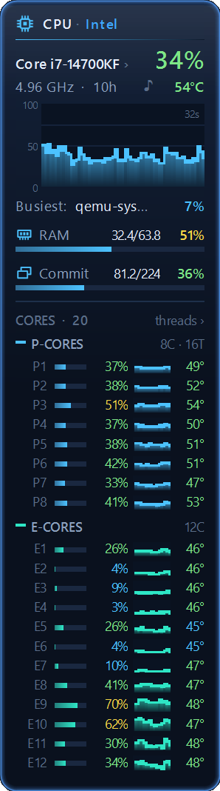
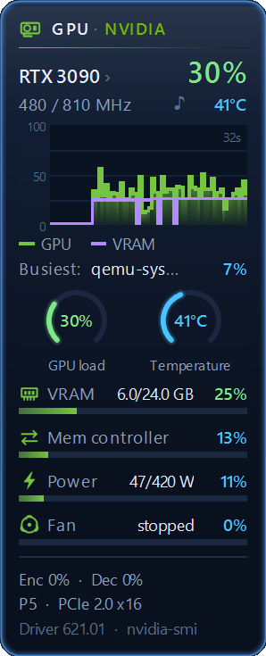
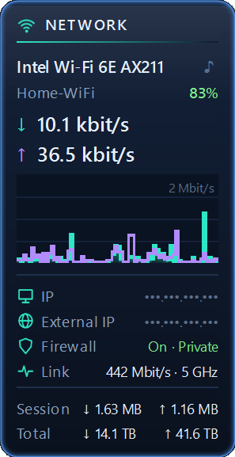
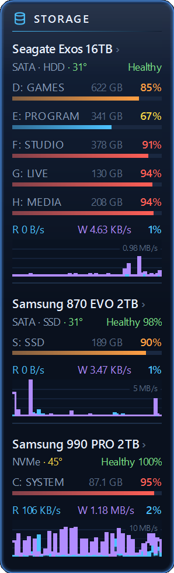
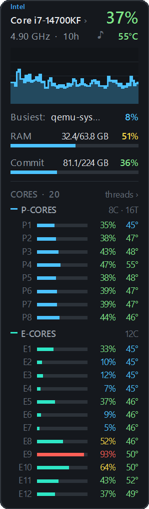
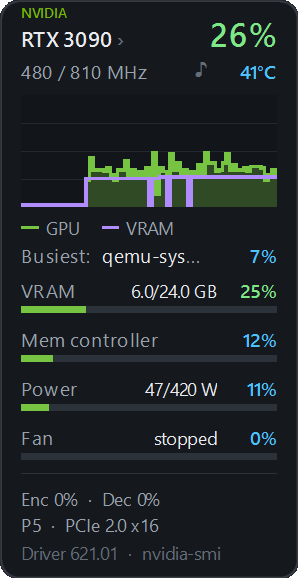
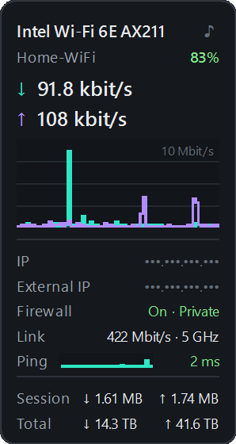
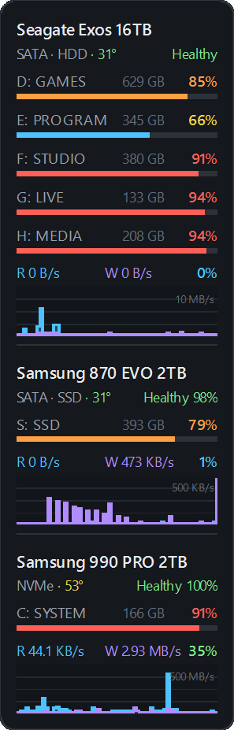

# Modern Meters

Four desktop gadgets for the Windows Sidebar from 8GadgetPack:

| Gadget | Shows |
|---|---|
| **CPU Meter Modern** | Load of every thread or core (P-cores and E-cores grouped), clock speed, temperature, RAM and commit, history graph |
| **GPU Meter Modern** | GPU load, VRAM, memory controller or shared memory, power, fan, clocks, encoder/decoder, temperature, history graph. NVIDIA, AMD and Intel, discrete and integrated, with the same sensors Task Manager uses |
| **Network Meter Modern** | Download and upload speed with an auto-scaled graph, Wi-Fi network and signal, IP addresses (hidden until clicked), firewall, traffic totals |
| **Drives Meter Modern** | Physical disks with their partitions, SMART health, SSD life left, temperature, read/write speed, activity graph |

All of them have English and Russian, five widths, accent colors, and a five-step color scale for load and temperature.

### Glass style

<table><tr valign="top">
<td></td>
<td></td>
<td></td>
<td></td>
</tr></table>

### Classic style

<table><tr valign="top">
<td></td>
<td></td>
<td></td>
<td></td>
</tr></table>

## Install

1. Install [8GadgetPack](https://8gadgetpack.net/) if you don't have the Sidebar yet.
2. Download the `.gadget` files from [Releases](https://github.com/Silverenio/modern-meters/releases/latest) and double-click each one you want. You don't need all four.
3. Right-click the desktop → **Gadgets**, and drag the gadget onto the desktop.
4. Settings: hover over the gadget and click the wrench icon.

## Optional extras

Everything works without them. They add data that Windows only gives to drivers or administrators.

| For | What to do |
|---|---|
| CPU temperature | Install [Core Temp](https://www.alcpu.com/CoreTemp/) and keep it running (it can start with Windows). Clicking "Core Temp off" on the gadget starts it, or opens the download page if it isn't installed. |
| GPU temperature on integrated graphics, watts on AMD/Intel | Discrete cards report temperature, fan, clocks and power (as % of the limit) by themselves. Integrated graphics often don't report temperature; run [LibreHardwareMonitor](https://github.com/LibreHardwareMonitor/LibreHardwareMonitor/releases) to fill it in. NVIDIA cards don't need it. |
| SSD life and temperature | Drives Meter settings → **SSD life & temperature** → **Turn on**, then approve the administrator prompt. This adds the scheduled task "ModernMeters Disk Health". It reads SSDs every 5 minutes and leaves hard drives alone so they can sleep. **Turn off** removes it. |

## Network access

- Network Meter looks up your external IP at api.ipify.org every 30 minutes and when the network changes. You can switch this off in its settings.
- Once a day one of the gadgets asks GitHub whether a newer release exists. If so, a "New version ›" line appears at the bottom of the gadgets and opens the release page. Nothing is downloaded or installed by itself. Settings → **About** → **New versions** → **Don't check** turns this off.

## Building from source

Run `build.ps1` in PowerShell. It draws the images, compiles the small Core Temp reader (`tools/coretemp`, with the C# compiler that comes with Windows), and puts the packages in `dist`. `build.ps1 -Install` also copies the gadgets into your Sidebar.

## Support

The gadgets are free. If you like them, you can [buy me a coffee on Ko-fi](https://ko-fi.com/silverenio). It's also in every gadget's settings under **About**.

## License

[MIT](LICENSE) © 2026 Silverenio

---

# Modern Meters (по-русски)

Четыре гаджета для боковой панели Windows из 8GadgetPack:

| Гаджет | Что показывает |
|---|---|
| **CPU Meter Modern** | Загрузку каждого потока или ядра (P- и E-ядра сгруппированы), частоту, температуру, ОЗУ и выделенную память, график |
| **GPU Meter Modern** | Загрузку GPU, видеопамять, контроллер памяти или общую память, мощность, вентилятор, частоты, кодер/декодер, температуру, график. NVIDIA, AMD и Intel, дискретные и встроенные, по тем же датчикам, что и Диспетчер задач |
| **Network Meter Modern** | Скорость загрузки и отдачи с автомасштабом графика, Wi-Fi сеть и сигнал, IP-адреса (скрыты, пока не кликнуть), брандмауэр, счётчики трафика |
| **Drives Meter Modern** | Физические диски с разделами, состояние SMART, остаток ресурса SSD, температуру, скорость чтения/записи, график активности |

У всех есть английский и русский язык, пять вариантов ширины, цвета акцента и пятиступенчатая цветовая шкала нагрузки и температуры. Как они выглядят, показано на скриншотах выше: стиль «Стекло» и классический.

## Установка

1. Установите [8GadgetPack](https://8gadgetpack.net/), если боковой панели ещё нет.
2. Скачайте `.gadget`-файлы со страницы [Releases](https://github.com/Silverenio/modern-meters/releases/latest) и дважды щёлкните каждый нужный. Ставить все четыре не обязательно.
3. Правый клик по рабочему столу → **Гаджеты**, перетащите гаджет на рабочий стол.
4. Настройки: наведите мышь на гаджет и нажмите на значок гаечного ключа.

## Необязательные дополнения

Всё работает и без них. Они добавляют данные, которые Windows отдаёт только драйверам или администратору.

| Для чего | Что сделать |
|---|---|
| Температура процессора | Установите [Core Temp](https://www.alcpu.com/CoreTemp/) и держите запущенным (может стартовать с Windows). Клик по «нет Core Temp» на гаджете запускает его, а если он не установлен — открывает страницу загрузки. |
| Температура встроенной графики, ватты AMD/Intel | Дискретные видеокарты сами сообщают температуру, вентилятор, частоты и мощность (в % от лимита). Встроенная графика часто не сообщает температуру — её добавит запущенный [LibreHardwareMonitor](https://github.com/LibreHardwareMonitor/LibreHardwareMonitor/releases). Картам NVIDIA он не нужен. |
| Ресурс и температура SSD | Настройки Drives Meter → **Ресурс и температура SSD** → **Включить**, затем подтвердите запрос администратора. Это добавит задачу Планировщика «ModernMeters Disk Health». Она опрашивает SSD раз в 5 минут, а жёсткие диски не трогает, чтобы они могли спать. **Выключить** удаляет её. |

## Обращения в интернет

- Network Meter узнаёт внешний IP у api.ipify.org раз в 30 минут и при смене сети. Это отключается в его настройках.
- Раз в сутки один из гаджетов спрашивает у GitHub, не вышла ли новая версия. Если вышла, внизу гаджетов появляется строка «Новая версия ›», которая открывает страницу выпуска. Сами гаджеты ничего не скачивают и не устанавливают. Отключается в настройках: **О гаджете** → **Новые версии** → **Не проверять**.

## Сборка из исходников

Запустите `build.ps1` в PowerShell. Он нарисует картинки, скомпилирует маленькую библиотеку для чтения Core Temp (`tools/coretemp`, компилятором C#, который есть в Windows) и положит пакеты в `dist`. `build.ps1 -Install` заодно установит гаджеты в боковую панель.

## Поддержать

Гаджеты бесплатные. Если они вам нравятся, можно [угостить меня кофе на Ko-fi](https://ko-fi.com/silverenio). Эта же ссылка есть в настройках каждого гаджета, в разделе **О гаджете**.

## Лицензия

[MIT](LICENSE) © 2026 Silverenio
